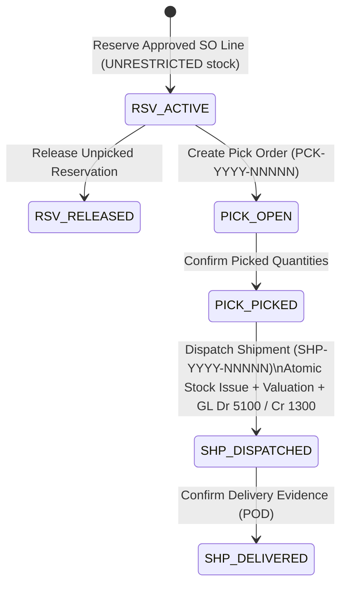

# ATH-S13 — Design Contract: Sales Reservation, Pick and Dispatch

**Slice:** S13 — Sales Reservation, Pick and Dispatch  
**Status:** Engineering design contract (Product Owner acceptance `PENDING`)  
**Prerequisites:** `S08` (Stock Availability, Locations, Lots & Quality Restrictions), `S12` (Customer Sales Orders & Commercial Commitments)  
**Authoritative Module Owners:** `Fulfillment` (`Orphac.Athera.Modules.Fulfillment`), `Inventory` (`Orphac.Athera.Modules.Inventory`), `Sales` (`Orphac.Athera.Modules.Sales`), `GeneralLedger` (`Orphac.Athera.Modules.GeneralLedger`)

---

## 1. Business Outcome & Scope

Warehouse operators can reserve eligible `UNRESTRICTED` available stock against approved sales order lines (`SO-YYYY-NNNNN`), release unpicked reservations, create and confirm warehouse pick orders (`PCK-YYYY-NNNNN`), and dispatch partial or full shipments (`SHP-YYYY-NNNNN`) with delivery confirmation evidence (`POD` / Surat Jalan). Dispatch atomically consumes the reservation, issues weighted-average inventory (`MOV-YYYY-NNNNN`), posts the balanced GL COGS entry (`Dr 5100 COGS_DEFAULT / Cr 1300 INVENTORY_ASSET`), and updates `SalesOrder` / `SalesOrderLine` fulfillment counters without overselling, negative stock, or using quarantined/blocked stock.

---

## 2. Domain Model & Schema Ownership (`fulfillment.*`, `inventory.*`, `sales.*`)

### 2.1 `fulfillment` Schema Tables (`M13_SalesReservationPickAndDispatch`)
All tables carry composite `(tenant_id, legal_entity_id)` foreign keys to `platform.legal_entities` and enforce PostgreSQL Row-Level Security (`ENABLE` + `FORCE ROW LEVEL SECURITY` using `platform.current_tenant_id()`):

1. **`fulfillment.pick_sequences`**:
   - `(tenant_id, legal_entity_id, fiscal_year)` PK, `last_number bigint >= 0` -> generates gap-free `PCK-{Year:D4}-{Seq:D5}`.
2. **`fulfillment.shipment_sequences`**:
   - `(tenant_id, legal_entity_id, fiscal_year)` PK, `last_number bigint >= 0` -> generates gap-free `SHP-{Year:D4}-{Seq:D5}`.
3. **`fulfillment.pick_orders` (`PickOrder`)**:
   - `pick_order_id uuid` PK, composite AK `(tenant_id, legal_entity_id, pick_order_id)`.
   - `pick_number varchar(40)` unique per `(tenant_id, legal_entity_id, pick_number)`.
   - `sales_order_id uuid` FK -> `sales.sales_orders(tenant_id, legal_entity_id, sales_order_id)`.
   - `sales_order_number_snapshot varchar(40)`, `revision_id uuid`.
   - `warehouse_id uuid` FK -> `inventory.warehouses(tenant_id, legal_entity_id, warehouse_id)`.
   - `warehouse_code_snapshot varchar(32)`.
   - `status varchar(24)` (`OPEN`, `PICKED`, `DISPATCHED`, `CANCELLED`).
   - `total_requested_base_quantity numeric(18,6)`, `total_picked_base_quantity numeric(18,6)`, `total_dispatched_base_quantity numeric(18,6)`.
   - `idempotency_key varchar(80)` unique per `(tenant_id, legal_entity_id, idempotency_key)`.
   - `notes varchar(300)`, `created_by_user_id uuid`, `picked_by_user_id uuid?`, `picked_at_utc timestamptz?`, `created_at_utc timestamptz`, `updated_at_utc timestamptz`, `version bigint`.
4. **`fulfillment.pick_lines` (`PickLine`)**:
   - `pick_line_id uuid` PK, composite FK to `fulfillment.pick_orders(tenant_id, legal_entity_id, pick_order_id)`.
   - `line_number int`, `so_line_id uuid`, `lineage_line_key varchar(32)`, `stock_reservation_id uuid` FK -> `inventory.stock_reservations`.
   - `item_id uuid`, `item_code_snapshot varchar(40)`, `item_name_snapshot varchar(160)`.
   - `base_uom_id uuid`, `base_uom_code_snapshot varchar(16)`.
   - `warehouse_id uuid`, `location_id uuid`, `location_code_snapshot varchar(32)`.
   - `stock_lot_id uuid?`, `lot_number_snapshot varchar(64)?`.
   - `requested_pick_base_quantity numeric(18,6) > 0`, `picked_base_quantity numeric(18,6) >= 0`, `dispatched_base_quantity numeric(18,6) >= 0`.
5. **`fulfillment.shipments` (`SalesShipment`)**:
   - `shipment_id uuid` PK, composite AK `(tenant_id, legal_entity_id, shipment_id)`.
   - `shipment_number varchar(40)` unique per `(tenant_id, legal_entity_id, shipment_number)`.
   - `pick_order_id uuid` FK -> `fulfillment.pick_orders`.
   - `sales_order_id uuid` FK -> `sales.sales_orders`, `sales_order_number_snapshot varchar(40)`, `revision_id uuid`.
   - `customer_partner_id uuid`, `customer_code_snapshot varchar(32)`, `customer_name_snapshot varchar(200)`, `delivery_address_snapshot varchar(240)`.
   - `dispatch_date date`, `status varchar(24)` (`DISPATCHED`, `DELIVERED`).
   - `carrier_name varchar(120)?`, `tracking_or_vehicle_number varchar(80)?`, `delivery_note_reference varchar(80)`.
   - `delivery_confirmed_by_name varchar(120)?`, `delivery_evidence_reference varchar(120)?`, `delivered_at_utc timestamptz?`, `delivery_confirmed_by_user_id uuid?`.
   - `stock_movement_id uuid`, `stock_movement_number varchar(40)`, `gl_journal_id uuid`, `gl_journal_number varchar(40)`.
   - `currency_code char(3)`, `total_dispatched_base_quantity numeric(18,6) > 0`, `total_cogs_amount numeric(18,2) >= 0`.
   - `idempotency_key varchar(80)` unique per `(tenant_id, legal_entity_id, idempotency_key)`.
   - `notes varchar(300)?`, `dispatched_by_user_id uuid`, `dispatched_at_utc timestamptz`, `created_at_utc timestamptz`, `updated_at_utc timestamptz`, `version bigint`.
6. **`fulfillment.shipment_lines` (`SalesShipmentLine`)**:
   - `shipment_line_id uuid` PK, composite FK to `fulfillment.shipments(tenant_id, legal_entity_id, shipment_id)`.
   - `line_number int`, `pick_line_id uuid`, `so_line_id uuid`, `lineage_line_key varchar(32)`, `stock_reservation_id uuid`.
   - `item_id uuid`, `item_code_snapshot varchar(40)`, `item_name_snapshot varchar(160)`.
   - `base_uom_id uuid`, `base_uom_code_snapshot varchar(16)`.
   - `warehouse_id uuid`, `location_id uuid`, `location_code_snapshot varchar(32)`.
   - `stock_lot_id uuid?`, `lot_number_snapshot varchar(64)?`.
   - `dispatched_base_quantity numeric(18,6) > 0`, `unit_cost_applied numeric(18,6) >= 0`, `line_cogs_amount numeric(18,2) >= 0`.
   - `movement_line_id uuid`, `valuation_entry_id uuid`.

### 2.2 State Machine

---

## 3. Application / API Contract (`/api/workspaces/{tenantId}/entities/{entityId}/fulfillment`)

- **Permissions**:
  - Read endpoints require `inventory.read`, `inventory.manage`, `sales.read`, `sales.manage`, or `sales.approve`.
  - Mutation endpoints (reserve, release, pick, dispatch, confirm delivery) require `inventory.manage`.
- **Endpoints**:
  1. `GET /api/workspaces/{tenantId}/entities/{entityId}/fulfillment/overview`:
     - Returns fulfillable approved sales orders (with per-line ordered/reserved/dispatched/remaining base quantities, active reservations, and eligible `UNRESTRICTED` location/lot balances), active reservations, pick orders, shipments, and `OD-10`/`OD-09` governance notices.
  2. `POST /api/workspaces/{tenantId}/entities/{entityId}/fulfillment/reservations`:
     - Reserves eligible `UNRESTRICTED` stock at `(locationId, stockLotId)` against an approved `(salesOrderId, soLineId)` with idempotency key.
  3. `POST /api/workspaces/{tenantId}/entities/{entityId}/fulfillment/reservations/{reservationId}/release`:
     - Releases unpicked reserved quantity and decrements `SalesOrderLine.ReservedBaseQuantity` / `SalesOrder.TotalReservedBaseQuantity`.
  4. `POST /api/workspaces/{tenantId}/entities/{entityId}/fulfillment/picks`:
     - Creates a `PickOrder` (`PCK-YYYY-NNNNN`) from active `SALES_ORDER` reservations on a sales order (optionally confirming picked quantities immediately when `confirmImmediately = true`).
  5. `POST /api/workspaces/{tenantId}/entities/{entityId}/fulfillment/picks/{pickOrderId}/confirm`:
     - Confirms picked quantities on an `OPEN` pick order (`OPEN` -> `PICKED`).
  6. `POST /api/workspaces/{tenantId}/entities/{entityId}/fulfillment/shipments`:
     - Dispatches a `PICKED` pick order (partial or full picked quantity), consuming the linked reservation(s), deducting `StockLocationBalance` & `StockPosition` (`OnHand` & `Reserved`), deducting moving-average `ValuationPool`, writing `StockMovement` (`SALES_DISPATCH_OUTBOUND`) + `ValuationEntry`, posting balanced GL journal (`Dr 5100 COGS_DEFAULT / Cr 1300 INVENTORY_ASSET`), updating `SalesOrderLine.DispatchedBaseQuantity` / `ReservedBaseQuantity`, and creating `SalesShipment` (`SHP-YYYY-NNNNN`).
  7. `POST /api/workspaces/{tenantId}/entities/{entityId}/fulfillment/shipments/{shipmentId}/confirm-delivery`:
     - Records customer delivery confirmation (`DELIVERED`, receiver name & POD evidence reference).

---

## 4. Negative Cases & Mandatory Executable Acceptance Tests

1. **Competing sales orders reserving the same stock (`S13_PG_01`)**: Two concurrent or sequential reservation requests competing for the same `UNRESTRICTED` balance serialize under PostgreSQL `FOR UPDATE` locking; total reserved never exceeds available (`409 od10_insufficient_available_stock`).
2. **Blocked / quarantined / expired lot & unapproved SO rejection (`S13_API_01`)**: Reserving or picking from `QUALITY_INSPECTION` (`LOC-QC`) or `BLOCKED` (`LOC-BLK`) stock, omitting a required lot (`lot_required_by_item_policy`), selecting an expired lot (`lot_expired_for_fulfillment`), or targeting an unapproved sales order fails with `409 Conflict`.
3. **Partial reserve, pick, partial dispatch, atomic weighted-average issue + GL COGS (`Dr 5100 / Cr 1300`), and retry idempotency (`S13_API_02`)**: Partial dispatch reduces `ReservedBaseQuantity` and `OnHandBaseQuantity` by the dispatched quantity, leaves `AvailableBaseQuantity` conserved, updates `SalesOrder.FulfillmentProgress` to `PARTIALLY_DISPATCHED`, posts balanced `Dr 5100 / Cr 1300` at moving-average unit cost, and idempotent replay returns `200 OK` without duplicate stock or GL entries.
4. **Order cancellation blocked while reserved/dispatched; release reservation unblocks (`S13_API_03`)**: Cancelling a sales order with active reservation fails with `409 so_has_downstream_fulfillment`; releasing the reservation restores availability and allows cancellation (when `TotalDispatchedBaseQuantity == 0`).
5. **Cross-tenant & multi-entity RLS isolation (`S13_PG_02` & `S13_API_04`)**: Direct SQL as `athera_app` and HTTP mutations with hostile tenant/entity selectors return `0` rows / `403` / `404`.
