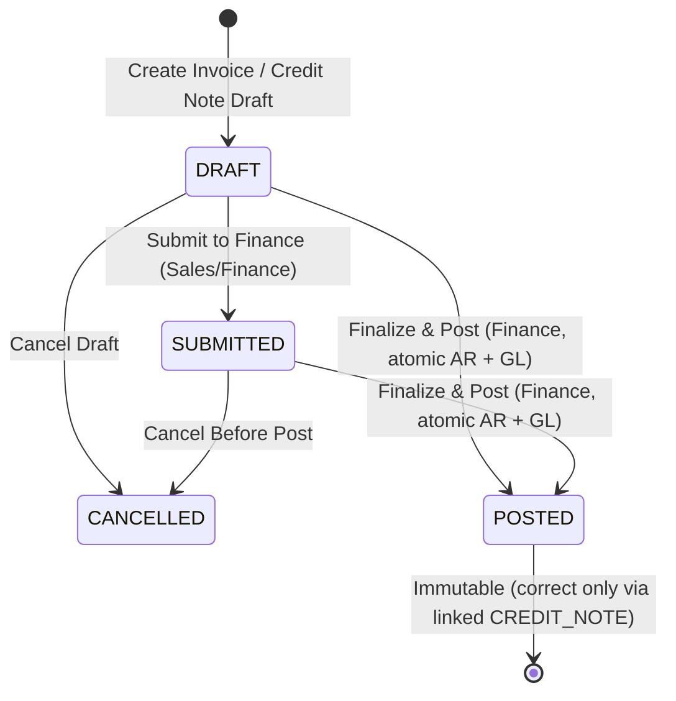

# ATH-S14 Design Contract — Customer Billing, Tax and Accounts Receivable

## 1. Scope & Module Ownership
- **Authoritative Modules:** `Billing` (`billing.*`), `Accounts Receivable` (`ar.*`), `General Ledger` (`gl.*`), `Tax` (`tax.*`), reading `Fulfillment` (`fulfillment.*`) and `Sales` (`sales.*`).
- **Business Outcome:** Finance can draft, preview, submit, and irreversibly post customer invoices against delivered/dispatched sales shipment lines using effective-dated legal-entity output tax codes, creating balanced `Dr 1200 AR / Cr 4100 Revenue + Cr 2210 PPN Keluaran` GL journals and source-linked `ar.customer_receivables` subledger records exactly once, plus issue compensating linked `CREDIT_NOTE` documents for post-posting corrections.
- **Explicit Non-Goals:** No automated DJP/e-Faktur filing, no cross-border/intercompany billing, no standalone non-delivery invoices (pending `OD-09`), and no customer cash receipt settlement (deferred to `S15`).

## 2. Aggregate Boundaries & State Machine

### Receivables State (`ar.customer_receivables`)
- Created atomically on `INVOICE` posting: `OPEN` (`OpenAmount = OriginalAmount`).
- Updated atomically on linked `CREDIT_NOTE` posting: `CreditedAmount += creditGrandTotal`, `OpenAmount = OriginalAmount - CreditedAmount - ReceivedAmount`. Transitions to `CREDITED` when `OpenAmount == 0` and `ReceivedAmount == 0`, or `SETTLED` when `OpenAmount == 0` with receipts (`S15`).

## 3. PostgreSQL Schema & Hardening (`M14_CustomerBillingTaxAndReceivables`)
All tables carry composite `(tenant_id, legal_entity_id)` scope, `ENABLE` + `FORCE ROW LEVEL SECURITY` using `platform.current_tenant_id()`, and least-privilege `athera_app` grants (no `DELETE`, no DDL):
1. `billing.invoice_sequences` (`tenant_id`, `legal_entity_id`, `year`, `last_number`) — `INV-YYYY-NNNNN`
2. `billing.credit_note_sequences` (`tenant_id`, `legal_entity_id`, `year`, `last_number`) — `CN-YYYY-NNNNN`
3. `ar.receivable_sequences` (`tenant_id`, `legal_entity_id`, `year`, `last_number`) — `AR-YYYY-NNNNN`
4. `billing.customer_invoices` — unique `(tenant_id, legal_entity_id, invoice_number)` and `(tenant_id, legal_entity_id, idempotency_key)`. Trigger `billing.guard_posted_invoice_immutability()` blocks any `UPDATE`/`DELETE` once `status = 'POSTED'`.
5. `billing.customer_invoice_lines` — references `billing.customer_invoices` and `fulfillment.shipment_lines` (and optional `original_invoice_line_id` for credit notes). Trigger `billing.guard_posted_invoice_line_immutability()` blocks `INSERT`/`UPDATE`/`DELETE` on lines belonging to a `POSTED` invoice.
6. `ar.customer_receivables` — unique `(tenant_id, legal_entity_id, receivable_number)` and unique `(tenant_id, legal_entity_id, invoice_id)`. `CHECK (original_amount > 0 AND credited_amount >= 0 AND received_amount >= 0 AND open_amount >= 0 AND open_amount = original_amount - credited_amount - received_amount)`.

## 4. Concurrency, Idempotency & Invariants
1. **No Double Billing:** Creating or posting an `INVOICE` acquires `FOR UPDATE` on every referenced `fulfillment.shipment_lines` row and verifies `existing_active_billed_qty + requested_qty <= dispatched_base_quantity`.
2. **No Duplicate Revenue / AR on Retries:** `IdempotencyKey` unique index returns existing invoice on retry; `GlPostingKernel` enforces unique `(source_module, source_document_id, source_event_key)` (`billing-invoice-post:{id:N}`); `ar.customer_receivables` enforces unique `invoice_id`.
3. **Decimal-Safe Arithmetic:** All quantities rounded to 6 decimals, IDR monetary amounts rounded to 2 decimals (`MidpointRounding.AwayFromZero`).
4. **Tax Evidence (`OD-07`):** Only `OUTPUT`, active, effective-dated tax codes on the legal entity are accepted. If `requires_tax_invoice_evidence` is true or treatment is `EXEMPT`/`ZERO_RATED`/`NOT_COLLECTED_FACILITY`, `tax_evidence_reference` is mandatory at posting time.
5. **Closed Period & Atomic Rollback:** Closed/locked financial period aborts posting cleanly before any commit; DB transaction rollback guarantees zero orphan AR, invoice status, or GL rows.

## 5. API Contract (`/api/workspaces/{tenantId}/entities/{entityId}/billing`)
- `GET /overview` (`canRead`): Returns KPIs (`unbilledDispatchedQty`, `draftInvoicesCount`, `postedRevenueTotal`, `openArTotal`), eligible unbilled shipments/lines with remaining billable capacity, output tax codes, customer invoices (with lines), and AR receivables subledger.
- `POST /invoices` (`canDraft`): Creates a `DRAFT` customer invoice against one or more unbilled shipment lines (with `IdempotencyKey`, `taxCodeId`, `invoiceDate`, `dueDate`, optional `taxEvidenceReference`).
- `POST /invoices/{invoiceId}/submit` (`canDraft`): Transitions `DRAFT` → `SUBMITTED`.
- `POST /invoices/{invoiceId}/post` (`canPost`): Atomically validates period, tax evidence, and capacity, posts balanced GL journal (`Dr 1200 / Cr 4100 + Cr 2210`), creates `ar.customer_receivables`, transitions invoice to `POSTED`, emits outbox & audit events.
- `POST /invoices/{invoiceId}/cancel` (`canDraft`): Cancels `DRAFT` or `SUBMITTED` invoice, releasing shipment billing capacity.
- `POST /credit-notes` (`canPost`): Atomically creates and posts a linked `CREDIT_NOTE` against a `POSTED` invoice (validating creditable qty, open period, and `Nota Retur` tax evidence), posts compensating GL (`Dr 4100 + Dr 2210 / Cr 1200`), and reduces `ar.customer_receivables.open_amount`.

## 6. Permissions
- `canRead`: `finance.read | finance.journal.post | sales.read | sales.manage | sales.approve`
- `canDraft`: `sales.manage | finance.journal.post`
- `canPost`: `finance.journal.post`
- Read-only enforcement verified on `NUSA-SBY` (`Budi Santoso` has `finance.read` + `sales.read` only); unauthorized `403` verified for `Rina Utami` (Procurement-only on `NUSA-JKT`).

## 7. Next.js Experience (`/w/[tenantId]/[entityId]/billing`, Impeccable)
- Archival-paper ledger aesthetic (`DESIGN.md`): 4-metric hairline KPI strip, collapsible `OD-07`/`OD-09` governance banner, horizontally scrollable 3-tab strip (`Siap Ditagih (SHP)`, `Faktur & Nota Kredit`, `Buku Pembantu Piutang (AR)`), inline invoice composer with live subtotal/tax/grand-total preview, irreversible posting confirmation drawer with Faktur Pajak evidence input and GL preview (`Dr 1200 / Cr 4100 / Cr 2210`), inline credit note drawer with `Nota Retur` input, `tabular-nums` alignment, and zero horizontal clipping across desktop & `390x844` mobile.

## 8. Mandatory Executable Tests
- **Unit (`S14BillingUnitTests.cs`):** Partial billing math, `PPN-OUT-11` vs `PPN-OUT-EXEMPT` tax computation, over-billing rejection, credit note capacity & AR reduction math.
- **PG18 Integration (`S14BillingPostgresTests.cs`):**
  - `S14_PG_01`: RLS tenant isolation + posted invoice/line immutability triggers + `athera_app` least privilege.
  - `S14_PG_02`: Concurrent invoicing on same shipment line (`FOR UPDATE` prevents double billing) + rollback atomicity.
  - `S14_API_01`: Full partial billing lifecycle (Draft -> Submit -> Post -> `Dr 1200 / Cr 4100 / Cr 2210` + `ar.customer_receivables`), duplicate idempotent submit, closed period block, tax status variants (`PPN-OUT-11` + `PPN-OUT-EXEMPT` missing/present evidence).
  - `S14_API_02`: Linked `CREDIT_NOTE` with `Nota Retur` posting compensating GL + reducing `ar.customer_receivables.open_amount`, over-credit rejection, and permission boundaries (`403` for `u1Id`, read-only on `NUSA-SBY` for `u2Id`, `404` cross-tenant).
- **Frontend:** Vitest (`s14-billing.test.tsx`) + Playwright E2E (`s14-billing-ar.spec.ts`) with 6 screenshots + `impeccable detect` (`[]`) + `impeccable-finish-reviewer` (`disposition: ship`).
