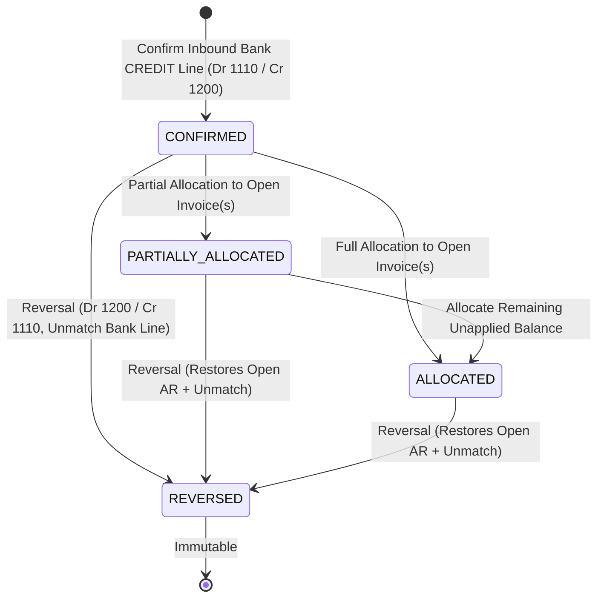

# ATH-S15 Design Contract — Customer Receipts, Allocation, AR Aging and Credits

## 1. Scope & Module Ownership
- **Authoritative Modules:** `Accounts Receivable` (`ar.*`), `Cash & Banking` (`cash.*`), `General Ledger` (`gl.*`).
- **Business Outcome:** Finance can import inbound bank statement `CREDIT` lines (with duplicate-import guard), confirm customer receipts (`Dr 1110 Bank / Cr 1200 AR Control`), allocate partial or full amounts across one or multiple open customer invoices while explicitly tracking unapplied funds, reverse receipts with compensating GL entries, and inspect real-time AR Aging with `GL 1200` control reconciliation.
- **Explicit Non-Goals:** No live bank API sync, payment gateway, factoring, or automated customer cash refunds (pending `OD-09`).

## 2. State Machine & Conservation

### Conservation Invariants
- `receipt.receipt_amount == receipt.allocated_amount + receipt.unapplied_amount` (`allocated >= 0`, `unapplied >= 0`)
- `receivable.open_amount == receivable.original_amount - receivable.credited_amount - receivable.received_amount` (`open >= 0`)
- `GL 1200 Net Debit Balance == Sum(ar.customer_receivables.open_amount) - Sum(active ar.customer_receipts.unapplied_amount)`
- One `cash.bank_statement_line` (`CREDIT`) can never be recognized by two active receipts (partial unique index + `FOR UPDATE` lock).

## 3. PostgreSQL Schema (`M15_CustomerReceiptsAllocationAndArAging`)
All tables carry `(tenant_id, legal_entity_id)`, `ENABLE` + `FORCE ROW LEVEL SECURITY` (`platform.current_tenant_id()`), and least-privilege `athera_app` grants (no `DELETE`):
1. `ar.receipt_sequences` (`tenant_id`, `legal_entity_id`, `fiscal_year`, `last_number`) — `RCT-YYYY-NNNNN`
2. `ar.customer_receipts` — unique `(tenant_id, legal_entity_id, receipt_number)`, unique `(tenant_id, legal_entity_id, idempotency_key)`, partial unique `(tenant_id, legal_entity_id, bank_statement_line_id) WHERE status <> 'REVERSED'`. Trigger `ar.guard_reversed_receipt_immutability()` prevents mutation after `REVERSED`.
3. `ar.receipt_allocations` — references `ar.customer_receipts` and `ar.customer_receivables`, `CHECK (allocated_amount > 0 AND status IN ('ACTIVE', 'REVERSED'))`.

## 4. API Contract (`/api/workspaces/{tenantId}/entities/{entityId}/receivables`)
- `GET /overview?asOfDate=YYYY-MM-DD` (`canRead`): KPIs + GL 1200 reconciliation proof, entity bank accounts, unmatched inbound `CREDIT` bank statement lines, customers, customer receipts + allocations, open receivables, and AR aging schedule (`Current`, `1-30`, `31-60`, `61-90`, `>90`).
- `POST /bank-statements/import` (`finance.journal.post`): Imports CSV bank statement lines via S11 `BankReconciliationCoordinator.ImportStatementAsync` with SHA-256 fingerprint deduplication.
- `POST /receipts` (`finance.journal.post`): Confirms a customer receipt from an unmatched `CREDIT` bank statement line, posts `Dr 1110 / Cr 1200`, and optionally applies initial invoice allocations atomically.
- `POST /receipts/{receiptId}/allocate` (`finance.journal.post`): Allocates unapplied receipt funds across one or more open customer receivables.
- `POST /receipts/{receiptId}/reverse` (`finance.journal.post`): Atomically reverses receipt, restores allocated invoices, unmatches bank line, and posts `Dr 1200 / Cr 1110`.

## 5. Next.js Experience (`/w/[tenantId]/[entityId]/receivables`, Impeccable)
- Archival-paper ledger aesthetic (`DESIGN.md`): 4-metric hairline KPI strip with live `GL 1200 == Subledger AR` proof badge, collapsible `OD-09` governance strip, horizontally scrollable 3-tab strip (`Mutasi Bank Masuk & Penerimaan`, `Alokasi Piutang (AR)`, `Umur Piutang (AR Aging)`), inline CSV statement import drawer, inline Confirm Receipt + Multi-Invoice Allocation drawer showing live `Diterima · Dialokasikan · Belum Dialokasikan` totals, Reversal drawer, and `NUSA-SBY` read-only enforcement.

## 6. Mandatory Executable Tests
- **Unit (`S15ReceivablesUnitTests.cs`):** Allocation conservation, over-allocation rejection, unapplied remainder tracking, reversal restoration, and AR aging bucket classification.
- **PG18 Integration (`S15ReceivablesPostgresTests.cs`):**
  - `S15_PG_01`: Forced RLS cross-tenant isolation + `ar.guard_reversed_receipt_immutability` + `athera_app` least privilege + duplicate bank statement fingerprint guard.
  - `S15_API_01`: CSV inbound `CREDIT` import -> confirm receipt -> partial multi-invoice allocation across 2 invoices leaving explicit unapplied remainder -> GL 1200 reconciliation proof -> AR aging buckets -> full reversal restoring open AR & bank line.
  - `S15_API_02`: Closed period block + out-of-order / over-allocation rejection + cross-tenant allocation denial + permission boundaries (`403` for `u1Id`, read-only on `NUSA-SBY` for `u2Id`, `404` foreign tenant).
- **Frontend:** Vitest (`s15-receivables.test.tsx`) + Playwright E2E (`s15-receivables-aging.spec.ts`) with 6 screenshots + `impeccable detect` (`[]`) + `impeccable-finish-reviewer` (`disposition: ship`).
