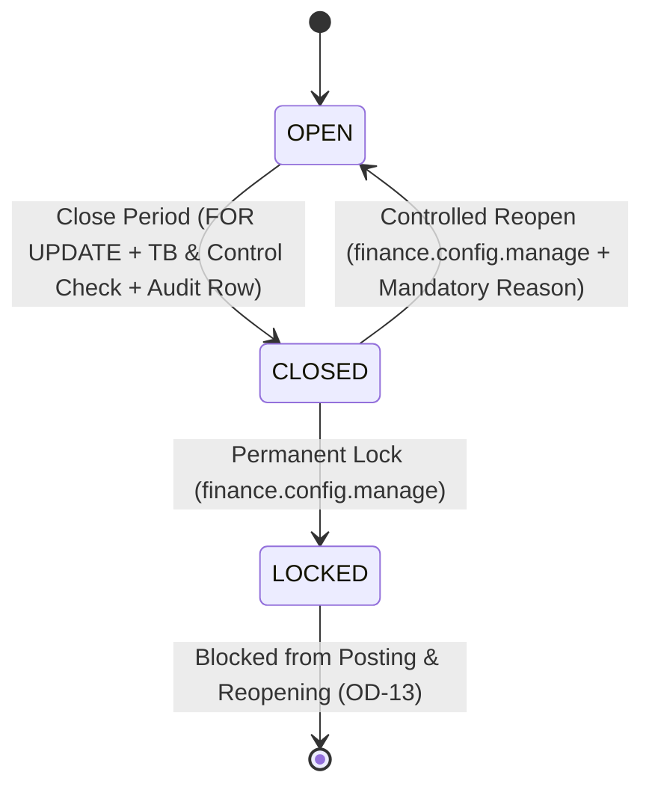

# ATH-S16 Design Contract — Accounting Reports, Reconciliations and Period Close

## 1. Scope & Module Ownership
- **Authoritative Modules:** `General Ledger` (`gl.*`) reading authoritative subledgers (`ap.*`, `ar.*`, `inventory.*`, `cash.*`) — zero shadow ledgers.
- **Business Outcome:** Finance controllers inspect a balanced Trial Balance, source-linked GL Account Detail drilldowns, Profit & Loss, Balance Sheet, 5-control GL-to-Subledger Reconciliations (`1120`, `1200`, `1300`, `2050 GRNI`, `2100 AP`), AP/AR Aging summaries, deterministic CSV export, and immutable period close/lock/reopen controls.
- **Explicit Non-Goals:** No multi-entity consolidation, intercompany eliminations, or regulator-certified statutory e-filing.

## 2. Period State Machine & Concurrency

- `GlPostingKernel.PostJournalAsync` locks/checks `FinancialPeriod.Status == OPEN`, and `Close`/`Lock`/`Reopen` lock the `gl.financial_periods` row with `FOR UPDATE`, eliminating close-vs-post race conditions.

## 3. PostgreSQL Schema (`M16_PeriodCloseAuditAndReconciliation`)
- `gl.period_close_reviews`: append-only immutable period close/lock/reopen audit table carrying `(tenant_id, legal_entity_id)`, `ENABLE` + `FORCE ROW LEVEL SECURITY` (`platform.current_tenant_id()`), `SELECT, INSERT` ONLY for `athera_app` (no `UPDATE`, no `DELETE`), and PostgreSQL trigger `gl.guard_period_close_review_immutability()` (`55000` on `UPDATE`/`DELETE`).

## 4. API Contract (`/api/workspaces/{tenantId}/entities/{entityId}/reports`)
- `GET /overview?periodId=...&asOfDate=YYYY-MM-DD` (`finance.read | finance.journal.post | finance.config.manage`): Trial Balance (opening, period activity, ending), Profit & Loss, Balance Sheet, 5-control Reconciliations (`1120`, `1200`, `1300`, `2050 GRNI`, `2100 AP`), AP & AR Aging totals, period list, and immutable close review audit log.
- `GET /accounts/{accountId}/ledger?periodId=...`: Source-linked GL Account Detail drilldown (`JournalNumber`, `PostingDate`, `SourceModule`, `SourceDocumentType`, `SourceDocumentId`, `DebitAmount`, `CreditAmount`, `RunningBalance`).
- `GET /trial-balance/export.csv?periodId=...`: Deterministic CSV export matching UI/API Trial Balance totals to the cent.
- `POST /periods/{periodId}/close` (`finance.config.manage | finance.journal.post`): Closes `OPEN` period with live TB/control verification and appends `gl.period_close_reviews`.
- `POST /periods/{periodId}/lock` (`finance.config.manage`): Permanently locks `CLOSED` period.
- `POST /periods/{periodId}/reopen` (`finance.config.manage`): Reopens `CLOSED` period with mandatory reason; blocks `LOCKED` period (`409 period_locked_reopen_blocked`).

## 5. Next.js Experience (`/w/[tenantId]/[entityId]/reports`, Impeccable)
- Finance cockpit with exceptions first: 4-metric hairline KPI strip (Trial Balance equilibrium, Net Income, Control Variance Count, Selected Period Status), collapsible `OD-11`/`OD-13` notice, period selector + CSV export CTA, 4 clean tabs (`Rekonsiliasi & Tutup Buku`, `Neraca Saldo (TB)`, `Laba Rugi & Neraca`, `Umur AP & AR`), click-to-source inline GL Account Detail drilldown sheet, and Period Close/Lock/Reopen confirmation drawer.

## 6. Mandatory Executable Tests
- **Unit (`S16ReportsUnitTests.cs`):** Trial balance equilibrium, P&L/Balance Sheet identity (`Assets == Liabilities + Equity + CurrentEarnings`), `FinancialPeriod.ReopenFromClosed` blocking `LOCKED`, and CSV formatter consistency.
- **PG18 Integration (`S16ReportsPostgresTests.cs`):**
  - `S16_PG_01`: Forced RLS + `gl.guard_period_close_review_immutability` (`42501` runtime / `55000` migrator) + multi-entity isolation.
  - `S16_API_01`: Trial Balance under reversals, 5-control reconciliation (including open GRNI), GL account drilldown traceability, CSV export consistency, and period close -> blocked posting -> controlled reopen -> lock -> blocked reopen.
  - `S16_API_02`: Permission boundaries (`403` for non-finance users, read-only on `NUSA-SBY`, `404` foreign tenant).
- **Frontend:** Vitest (`s16-reports.test.tsx`) + Playwright E2E (`s16-reports-period-close.spec.ts`) with 6 screenshots + `impeccable detect` (`[]`) + `impeccable-finish-reviewer` (`disposition: ship`).
