```mermaid
flowchart LR
    subgraph Foundation ["Core Foundation"]
        S00["S00 Architecture & RLS"] --> S01["S01 Tenancy & RBAC"]
        S01 --> S02["S02 Org Admin & Outbox"]
        S02 --> S03["S03 Partners & Catalog"]
        S03 --> S04["S04 Finance, Tax & GL"]
    end

    subgraph P2P ["Procure to Pay"]
        S04 --> S05["S05 Purchase Orders"]
        S05 --> S06["S06 Gate 1 Dock Custody"]
        S06 --> S07["S07 Gate 2 Valuation & GRNI"]
        S07 --> S08["S08 Warehouse & Lots"]
        S07 --> S09["S09 Supplier Bills & AP"]
        S09 --> S10["S10 Returns & Debit Notes"]
        S09 --> S11["S11 Payments & Bank Recon"]
    end

    subgraph O2C ["Order to Cash"]
        S04 --> S12["S12 Sales Orders & Credit"]
        S08 --> S13["S13 Reservations & COGS"]
        S12 --> S13
        S13 --> S14["S14 Customer Billing & AR"]
        S14 --> S15["S15 Customer Receipts & Aging"]
    end

    subgraph Governance ["Governance & Reporting"]
        S11 --> S16["S16 Reconciliations & Close"]
        S15 --> S16
        S16 --> S17["S17 Documents & Evidence"]
        S17 --> S18["S18 RC, Security & UAT"]
    end
```

# Orphac Athera — Engineering and Operational Handover

**Release Candidate:** `1.0.0-rc1`  
**Git Branch:** `greenfield/mvp`  
**Verified Environment:** Local, synthetic fixtures only

**Date:** November 19, 2026  
**Document Status:** Engineering evidence ready for Owner review; real-data pilot **BLOCKED**

**Product Owner Acceptance:** `PENDING` (Human Product Owner sign-off required)

---

## 1. Executive Summary

Orphac Athera is an industry-neutral, multi-tenant ERP for Indonesian SMEs. Manufacturing is outside MVP scope. The local build exercises both procure-to-pay and order-to-cash; it is not an approved release.

This handover document provides technical leads, operations/DevOps engineers, QA leads, and business stakeholders with the comprehensive reference required to understand, operate, test, deploy, and maintain the system.

### Core Stack
| Layer | Technologies | Version |
| :--- | :--- | :--- |
| **Backend API** | ASP.NET Core, C# 13 | 10.0 |
| **ORM / Data Access** | Entity Framework Core, Npgsql | 10.0 |
| **Database** | PostgreSQL | 18 |
| **Frontend Web** | Next.js (App Router, Turbopack), React, TypeScript, Tailwind CSS | 16.4.6 / React 19 |
| **API Contract** | OpenAPI 3.0 + typed TypeScript client (`openapi-fetch`) | v1 |
| **Testing** | xUnit (.NET Unit & Real PostgreSQL Integration), Vitest, Playwright | Latest |

---

## 2. Greenfield Non-Negotiable Invariants

Use these controls when reviewing S00–S18. Policy exceptions that affect irreversible entries are listed in section 6.

1. **Strict Tenancy and Entity Isolation:** Every protected API operation requires explicit `app.tenant_id` and legal entity authorization. Client identifiers are selectors only; entitlements are resolved server-side before SQL execution.
2. **PostgreSQL Row-Level Security (RLS) Enforcement:** The drill counted 109 forced-RLS tables with `tenant_id`. `S18_SEC_01` separately checks for ordinary tables with `tenant_id` missing either RLS flag. Missing tenant context denies the runtime role access to tenant rows. RLS does not protect against compromise of the application server.
3. **Least-Privilege Database Roles:**
   - `athera_migrator`: Owns schemas and tables; executes EF Core migrations; lacks application runtime access.
   - `athera_app`: Non-superuser, `NOCREATEDB`, `NOBYPASSRLS`; owns 0 tables; restricted strictly to `SELECT`, `INSERT`, `UPDATE`, `DELETE` grants via RLS policies.
   - `athera_dev_admin`: Development/staging administrative and backup principal with `BYPASSRLS` privileges for `pg_dump`.
4. **Credential and Authentication Authority:** ASP.NET Core Identity owns credentials. The same-origin session cookie is `HttpOnly`, `SameSite=Lax`, and `Secure` outside Development/Testing. Mutations require CSRF protection; the browser stores no auth token in `localStorage`.
5. **Exact Decimal-Safe Monetary Arithmetic:** All prices, valuations, currency conversions, and unit-of-measure quantities use decimal-safe arithmetic (`decimal` in C#, `numeric(18,4)` / `numeric(18,2)` in PostgreSQL). Floating-point arithmetic (`float`, `double`) is strictly forbidden for financial and stock calculations.
6. **Immutable Financial and Valuation Records:** Posted General Ledger (GL) journals, inventory valuation postings, invoices, payments, and audit logs are append-only and immutable. Erroneous postings are corrected exclusively via linked compensating reversal entries, never by updating or deleting historical records.
7. **Balanced General Ledger Postings:** Every posted journal entry must strictly balance ($\sum \text{Debit} = \sum \text{Credit}$). Single-sided postings are structurally rejected.
8. **Transactional Idempotency:** Financial and inventory transactions require unique client idempotency source keys. Concurrent duplicate retries return the original committed transaction result without duplicating GL, inventory, or billing effects.
9. **Two-Gate Receiving and Custody Separation:**
   - **Gate 1 (Dock Custody):** Goods receipt is strictly unvalued physical custody. Damaged or rejected quantities are isolated immediately. Gate 1 generates zero GL journal postings and zero GRNI accruals.
   - **Gate 2 (Valued Acceptance):** Technical inspection and valued acceptance post atomically to Inventory Asset (`1300`) and Goods Received Not Invoiced (`2110 GRNI`), triggering weighted-average inventory revaluation.
10. **Three-Way Invoice Matching and Price Variance Apportionment:** Supplier bills require 3-way matching against approved POs and accepted Gate 2 goods receipts. Purchase price variances (`DEC-P2P-013`) are apportioned between remaining on-hand stock and Purchase Price Variance (`5200 PPV`).
11. **Effective-Dated Indonesian Tax Configuration:** The build demonstrates PPN and PPh 23, with evidence required according to the configured treatment. Demo codes are not statutory determinations. No PPh 22, PPh 4(2), bank submission or DJP filing is claimed.
12. **Pure Greenfield Core:** The core ERP contains zero industry-specific manufacturing entities and zero legacy migrations or dependencies.

---

## 3. Slice Delivery Map (`S00`–`S18`)

The [slice ledger](../implementation/WORKSTREAM-STATE.md) records the delivery history. The diagram shows dependencies, not Owner acceptance:



### Where facts live

There are 19 named application schemas: `platform`, `identity`, `approval`, `audit`, `integration`, `partners`, `catalog`, `gl`, `tax`, `procurement`, `inventory`, `quality`, `ap`, `cash`, `sales`, `fulfillment`, `billing`, `ar`, `documents`. API and screen names are not necessarily schema names: for example, `/payables` serves AP and `/reports` reads accounting controls. See the [domain boundaries](../architecture/ATH-DOMAIN-BOUNDARIES-001.md), [OpenAPI contract](../contracts/openapi.v1.json) and [slice designs](../design/slices/) for ownership and entry points.

---

## 4. Quality, Testing & Security Evidence

### 1. Test Suite Pass Rates
- **Backend:** [79 unit + 100 PostgreSQL integration tests passed](../evidence/S18/dotnet-test.log). `S18_RC_01` takes five actors through a partial purchase and sale, verifies a trial balance of IDR 7,550,000 per side and five zero-variance controls, then tests close, reopen and lock.
- **Frontend Vitest Unit Tests:** **`50 / 50` PASSED** (Component rendering, formatters, i18n, state management).
- **Playwright:** [31/31 Chromium tests passed](../evidence/S18/frontend-and-e2e.log) using freshly seeded fixtures. The S18 browser walkthrough checks selected pages at 1280, 768 and 390 px and one Tab focus target; it is not a keyboard accessibility certification.
- **OpenAPI Type Sync:** Diff between OpenAPI schema and generated TypeScript client: **0 diff (`api:check` clean)**.

### 2. PostgreSQL 18 Security Audit (`S18_SEC_01`)
- **RLS:** The restored database and its source each had 109 forced-RLS tables with `tenant_id`.
- **Least-Privilege Role Verified:** `athera_app` role verified as non-superuser, `rolbypassrls = false`, and owning 0 tables.
- **Scope checks:** 14 read endpoints reject anonymous, unassigned and foreign callers. `S18_SEC_02` exercises two valid-body writes and 12 empty-body routes; selected table counts remain unchanged. These are bounded authorization checks, not a penetration test.

### 3. Concurrency & Stress Soak (`S18_CONCURRENCY_01`)
- **12-Way Concurrent Journal Posting:** 6 unique journal keys submitted twice concurrently. Zero duplicate postings created; General Ledger Trial Balance remained strictly balanced ($\sum \text{Debit} = \sum \text{Credit}$).
- **8-Way Concurrent Stock Reservation:** 8 parallel reservation requests stressing available inventory. Strict concurrency guards prevented negative stock and over-allocation.

### 4. Vulnerability & Secrets Audit
- [Dependency audit](../evidence/S18/dependency-audit.log): NuGet including transitive dependencies and npm production dependencies. Results apply to the audit sources at scan time.
- [Secrets check](../evidence/S18/secrets-scan.log): selected key/token signatures only, not proof of absence.

### 5. Disaster Recovery & Migration Rollback Rehearsal
- **Recovery:** [Saved local drill](../evidence/S18/backup-restore-and-migration-drill.log) compares tenants (2), entities (3), journals (32), documents (1) and the forced-RLS count (109) before and after restore. It does not compare every row or sequence.
- **Rollback:** On the disposable restored copy only, `M17 -> M16 -> M17` removed then recreated `documents.business_documents`. This proves schema transition, not document-data preservation. Do not downgrade a real database using this drill.

---

## 5. Operations & Deployment Runbook

### Environment Bootstrap (Local / Dev)

#### Prerequisites
- Docker Engine 24+ & Docker Compose v2
- .NET 10.0 SDK
- Node.js 22+ & npm 10+
- PostgreSQL 18 client tools or the local PostgreSQL 18 container

#### Step-by-Step Launch
```bash
# 1. Clone repository and navigate to root
cd Orphac.Athera

# 2. Start PostgreSQL 18 development container
./scripts/dev/bootstrap-postgres.sh

# 3. Export the local role-specific connection strings and demo password
# as described in the runbook. Never use real data or credentials here.
# 4. Apply Modules migrations and seed synthetic fixtures via the API CLI
ASPNETCORE_ENVIRONMENT=Development dotnet run --project src/Orphac.Athera.Api -- --migrate --seed-demo

# 5. Launch API (Port 5200) using ConnectionStrings__Runtime, not the migrator
ASPNETCORE_ENVIRONMENT=Development dotnet run --project src/Orphac.Athera.Api --no-launch-profile

# 6. In a separate terminal, install and launch Web Frontend (Port 3200)
cd apps/web
npm ci
npm run build
npm run start
```

### Verification Commands
```bash
# Run all .NET Unit and PostgreSQL Integration Tests
dotnet test

# Verify OpenAPI TypeScript client synchronization
npm --prefix apps/web run api:check

# Run Web Unit Tests
npm --prefix apps/web test

# Run End-to-End Playwright Regression Suite
npm --prefix apps/web run e2e:fresh
```

### Database Backup & Restore Procedure
Because all tenant tables enforce `FORCE ROW LEVEL SECURITY`, backup operations must run under the `athera_dev_admin` role (which has `BYPASSRLS` privileges):

```bash
# Backup database to custom archive format
PGPASSWORD="athera_dev_local_admin_pw" pg_dump \
  -h 127.0.0.1 -p 55433 -U athera_dev_admin \
  -F c -b -v -f /tmp/athera_backup.dump athera_dev

# Restore into target database
PGPASSWORD="athera_dev_local_admin_pw" pg_restore \
  -h 127.0.0.1 -p 55433 -U athera_dev_admin \
  -d athera_target_db -v /tmp/athera_backup.dump
```

---

## 6. Open Business Policy Decisions (`OD-01`–`OD-13`)

The [decision register](../product/ATH-OPEN-DECISIONS-001.md) is authoritative for all 13 decisions. The build does **not** enforce every interim restriction. [ATH-CR-015](../decisions/ATH-CR-015-live-posting-paths-under-open-decisions.md) identifies five groups of irreversible postings still executable under unsigned rules: price-variance bills, supplier returns, payment release, tax on posted transactions and customer corrections. File preparation alone posts nothing; an authorized release **does** debit AP and credit outbound clearing. Do not put real business data into this build pending Owner/Finance disposition and verification of any required changes.

---

## 7. Product Owner Acceptance Protocol

Local automated checks passed. The [unsigned packet](../evidence/S18/PO-FOUR-PILLAR-ACCEPTANCE-PACKET.md) follows the [Owner governance contract](../governance/ATH-PO-GOVERNANCE-001.md):

1. **Business behavior:** demonstrate normal and exception paths against approved policy.
2. **Module ownership:** identify the authoritative module for each fact and review cross-module writes.
3. **Critical invariants:** review financial integrity, isolation, quantity, retries and atomicity.
4. **Acceptance evidence:** review the exact SHA, executable evidence, visual and operational findings, and unresolved exceptions.

> [!IMPORTANT]
> The Product Owner signature sections in the acceptance packet remain unsigned (`PENDING`). Only the authorized human Product Owner may execute final sign-off before staging or pilot deployment.

---

## 8. Handover Contacts & Directory Index

### Key Documentation References
- [Operations runbook](../runbooks/LOCAL_AND_STAGING_OPERATIONS_RUNBOOK.md)
- [Workstream ledger](../implementation/WORKSTREAM-STATE.md) and [release evidence index](../evidence/S18/README.md)
- [Observability and privacy findings](../evidence/S18/observability-privacy-review.md) and [UX critique](../evidence/S18/impeccable-review.md)
