# Orphac Athera — Engineering and Operational Handover

**Release Candidate:** `1.0.0-rc1`  
**Git Branch:** `greenfield/mvp`  
**Target Environment:** Local Development, CI/CD, and Staging Demonstration  
**Date:** November 19, 2026  
**Document Status:** Complete & Approved for Handover  
**Product Owner Acceptance:** `PENDING` (Human Product Owner sign-off required)

---

## 1. Executive Summary

Orphac Athera is a greenfield Enterprise Resource Planning (ERP) platform architected specifically for Indonesian mid-market distribution, trading, and light assembly enterprises.

This handover document provides technical leads, operations/DevOps engineers, QA leads, and business stakeholders with the comprehensive reference required to understand, operate, test, deploy, and maintain the system.

### Core Stack
| Layer | Technologies | Version |
| :--- | :--- | :--- |
| **Backend API** | ASP.NET Core, C# 13 | 10.0 |
| **ORM / Data Access** | Entity Framework Core, Npgsql | 10.0 |
| **Database** | PostgreSQL | 18 |
| **Frontend Web** | Next.js (App Router, Turbopack), React, TypeScript, Tailwind CSS | 16.4.6 / React 19 |
| **API Contract** | OpenAPI 3.0 + typed TypeScript client (`openapi-fetch`) | v1 |
| **Testing** | xUnit (.NET Unit & Real PostgreSQL Integration), Vitest, Playwright | Latest |

---

## 2. Greenfield Non-Negotiable Invariants

The codebase enforces 12 immutable architectural and financial invariants across all 19 implementation slices:

1. **Strict Tenancy and Entity Isolation:** Every protected API operation requires explicit `app.tenant_id` and legal entity authorization. Client identifiers are selectors only; entitlements are resolved server-side before SQL execution.
2. **PostgreSQL Row-Level Security (RLS) Enforcement:** Every tenant-scoped table (`109` tables across `18` schemas) enforces `ENABLE ROW LEVEL SECURITY` and `FORCE ROW LEVEL SECURITY`. Missing or invalid session context denies all access (`NOBYPASSRLS`).
3. **Least-Privilege Database Roles:**
   - `athera_migrator`: Owns schemas and tables; executes EF Core migrations; lacks application runtime access.
   - `athera_app`: Non-superuser, `NOCREATEDB`, `NOBYPASSRLS`; owns 0 tables; restricted strictly to `SELECT`, `INSERT`, `UPDATE`, `DELETE` grants via RLS policies.
   - `athera_dev_admin`: Development/staging administrative and backup principal with `BYPASSRLS` privileges for `pg_dump`.
4. **Credential and Authentication Authority:** ASP.NET Core Identity is the sole credential authority. Authentication uses secure same-origin cookie sessions (`SameSite=Strict`, `HttpOnly`, `Secure`) with anti-forgery CSRF tokens. No tokens are stored in browser `localStorage`.
5. **Exact Decimal-Safe Monetary Arithmetic:** All prices, valuations, currency conversions, and unit-of-measure quantities use decimal-safe arithmetic (`decimal` in C#, `numeric(18,4)` / `numeric(18,2)` in PostgreSQL). Floating-point arithmetic (`float`, `double`) is strictly forbidden for financial and stock calculations.
6. **Immutable Financial and Valuation Records:** Posted General Ledger (GL) journals, inventory valuation postings, invoices, payments, and audit logs are append-only and immutable. Erroneous postings are corrected exclusively via linked compensating reversal entries, never by updating or deleting historical records.
7. **Balanced General Ledger Postings:** Every posted journal entry must strictly balance ($\sum \text{Debit} = \sum \text{Credit}$). Single-sided postings are structurally rejected.
8. **Transactional Idempotency:** Financial and inventory transactions require unique client idempotency source keys. Concurrent duplicate retries return the original committed transaction result without duplicating GL, inventory, or billing effects.
9. **Two-Gate Receiving and Custody Separation:**
   - **Gate 1 (Dock Custody):** Goods receipt is strictly unvalued physical custody. Damaged or rejected quantities are isolated immediately. Gate 1 generates zero GL journal postings and zero GRNI accruals.
   - **Gate 2 (Valued Acceptance):** Technical inspection and valued acceptance post atomically to Inventory Asset (`1300`) and Goods Received Not Invoiced (`2110 GRNI`), triggering weighted-average inventory revaluation.
10. **Three-Way Invoice Matching and Price Variance Apportionment:** Supplier bills require 3-way matching against approved POs and accepted Gate 2 goods receipts. Purchase price variances (`DEC-P2P-013`) are apportioned between remaining on-hand stock and Purchase Price Variance (`5200 PPV`).
11. **Effective-Dated Indonesian Tax Rules:** Tax calculations (`PPN 11%/12%`, `PPh 22`, `PPh 23`, `PPh 4(2)`) are effective-dated, transaction-specific, and require auditable evidence (`Faktur Pajak`, `SKB`, `Nota Retur`).
12. **Pure Greenfield Core:** The core ERP contains zero industry-specific manufacturing entities and zero legacy migrations or dependencies.

---

## 3. Slice Delivery Map (`S00`–`S18`)

All 19 slices have completed implementation, unit testing, PostgreSQL 18 integration testing, and Playwright E2E verification:

```mermaid
flowchart LR
    subgraph Foundation ["Core Foundation"]
        S00["S00 Architecture & RLS"] --> S01["S01 Tenancy & RBAC"]
        S01 --> S02["S02 Org Admin & Outbox"]
        S02 --> S03["S03 Partners & Catalog"]
        S03 --> S04["S04 Finance, Tax & GL"]
    end

    subgraph P2P ["Procure to Pay"]
        S04 --> S05["S05 Purchase Orders"]
        S05 --> S06["S06 Gate 1 Dock Custody"]
        S06 --> S07["S07 Gate 2 Valuation & GRNI"]
        S07 --> S08["S08 Warehouse & Lots"]
        S07 --> S09["S09 Supplier Bills & AP"]
        S09 --> S10["S10 Returns & Debit Notes"]
        S09 --> S11["S11 Payments & Bank Recon"]
    end

    subgraph O2C ["Order to Cash"]
        S04 --> S12["S12 Sales Orders & Credit"]
        S08 --> S13["S13 Reservations & COGS"]
        S12 --> S13
        S13 --> S14["S14 Customer Billing & AR"]
        S14 --> S15["S15 Customer Receipts & Aging"]
    end

    subgraph Governance ["Governance & Reporting"]
        S11 --> S16["S16 Reconciliations & Close"]
        S15 --> S16
        S16 --> S17["S17 Documents & Evidence"]
        S17 --> S18["S18 RC, Security & UAT"]
    end
```



### Slice Details

| Slice | Module Name | Schemas Owned | Key APIs | Web Route |
| :--- | :--- | :--- | :--- | :--- |
| **S00** | Architecture, Auth & Security Kernel | `security`, `tenancy` | `/api/auth/*` | `/login` |
| **S01** | Multi-Tenancy, Entity Scoping & RBAC | `tenancy`, `security` | `/api/workspaces/*` | `/workspaces`, `/` |
| **S02** | Org Admin, Invitations & Outbox | `tenancy`, `security`, `outbox` | `/api/workspaces/{t}/admin/*` | `/w/[t]/[e]/admin`, `/invitations` |
| **S03** | Partners & Multi-UoM Item Catalog | `partners`, `catalog` | `/api/workspaces/{t}/entities/{e}/partners/*` | `/w/[t]/[e]/partners`, `/catalog` |
| **S04** | Finance Core, Tax Engine & GL Kernel | `finance`, `taxation` | `/api/workspaces/{t}/entities/{e}/finance/*` | `/w/[t]/[e]/finance` |
| **S05** | Procurement, POs & Four-Eyes Approvals | `procurement` | `/api/workspaces/{t}/entities/{e}/procurement/*` | `/w/[t]/[e]/procurement` |
| **S06** | Gate 1 Dock Receiving (Unvalued Custody)| `receiving` | `/api/workspaces/{t}/entities/{e}/receiving/*` | `/w/[t]/[e]/receiving` |
| **S07** | Gate 2 Valued Acceptance & GRNI | `receiving`, `inventory`, `finance` | `/api/workspaces/{t}/entities/{e}/receiving/inspections` | `/w/[t]/[e]/receiving` |
| **S08** | Warehouse Locations, Lots & Quality | `inventory` | `/api/workspaces/{t}/entities/{e}/inventory/*` | `/w/[t]/[e]/inventory` |
| **S09** | Supplier Bills, 3-Way Match & AP | `payables`, `taxation`, `finance` | `/api/workspaces/{t}/entities/{e}/payables/*` | `/w/[t]/[e]/payables` |
| **S10** | Supplier Returns, Replacements & Credits| `returns`, `inventory`, `payables` | `/api/workspaces/{t}/entities/{e}/returns/*` | `/w/[t]/[e]/returns` |
| **S11** | Payments, Clearing & Bank Reconciliation| `payments`, `banking` | `/api/workspaces/{t}/entities/{e}/payments/*` | `/w/[t]/[e]/payments` |
| **S12** | Sales Orders & Credit Limit Control | `sales` | `/api/workspaces/{t}/entities/{e}/sales-orders/*` | `/w/[t]/[e]/sales-orders` |
| **S13** | Reservations, Pick, Dispatch & COGS | `fulfillment`, `inventory`, `finance`| `/api/workspaces/{t}/entities/{e}/fulfillment/*` | `/w/[t]/[e]/fulfillment` |
| **S14** | Customer Billing, Output Tax & AR | `billing`, `taxation`, `finance` | `/api/workspaces/{t}/entities/{e}/billing/*` | `/w/[t]/[e]/billing` |
| **S15** | Customer Receipts, Allocations & Aging | `receivables`, `banking` | `/api/workspaces/{t}/entities/{e}/receivables/*` | `/w/[t]/[e]/receivables` |
| **S16** | Accounting Reports, 5-Control Recon & Close| `reporting`, `finance` | `/api/workspaces/{t}/entities/{e}/reports/*` | `/w/[t]/[e]/reports` |
| **S17** | Documents, Signed URLs & Audit Trails | `documents`, `audit` | `/api/workspaces/{t}/entities/{e}/documents/*` | `/w/[t]/[e]/documents` |
| **S18** | Cross-Module UAT, Security & Concurrency| All Schemas | Full Surface | App Shell (All Viewports) |

---

## 4. Quality, Testing & Security Evidence

### 1. Test Suite Pass Rates
- **Backend .NET Tests:** **`176 / 176` PASSED** (`79` Unit Tests + `97` Real PostgreSQL 18 Integration Tests). Zero tests use EF InMemory or SQLite; all integration tests execute against real PostgreSQL 18 with active RLS.
- **Frontend Vitest Unit Tests:** **`50 / 50` PASSED** (Component rendering, formatters, i18n, state management).
- **Playwright E2E Integration Specs:** **`31 / 31` PASSED** (Desktop 1280px/1440px, Tablet 768px, Mobile 390px viewports, zero layout clipping, keyboard accessible).
- **OpenAPI Type Sync:** Diff between OpenAPI schema and generated TypeScript client: **0 diff (`api:check` clean)**.

### 2. PostgreSQL 18 Security Audit (`S18_SEC_01`)
- **109 Tables Verified:** All 109 tenant-scoped tables across all 18 module schemas have `rowsecurity = true` (`ENABLE ROW LEVEL SECURITY`) and `forcerowsecurity = true` (`FORCE ROW LEVEL SECURITY`).
- **Least-Privilege Role Verified:** `athera_app` role verified as non-superuser, `rolbypassrls = false`, and owning 0 tables.
- **Cross-Tenant Fuzzing:** Automated security fuzzing across 14 module API endpoints verified that unauthenticated requests return `401 Unauthorized`, and authenticated requests targeting foreign tenants return `403 Forbidden` or `404 Not Found` with zero data leakage.

### 3. Concurrency & Stress Soak (`S18_CONCURRENCY_01`)
- **12-Way Concurrent Journal Posting:** 6 unique journal keys submitted twice concurrently. Zero duplicate postings created; General Ledger Trial Balance remained strictly balanced ($\sum \text{Debit} = \sum \text{Credit}$).
- **8-Way Concurrent Stock Reservation:** 8 parallel reservation requests stressing available inventory. Strict concurrency guards prevented negative stock and over-allocation.

### 4. Vulnerability & Secrets Audit
- **NuGet Vulnerabilities:** `0` vulnerable packages detected (`dotnet list package --vulnerable`).
- **NPM Vulnerabilities:** `0` vulnerable packages detected (`npm audit`).
- **Secrets Scan:** Repository scan confirmed zero committed private keys, live credentials, or production tokens (`docs/evidence/S18/secrets-scan.log`).

### 5. Disaster Recovery & Migration Rollback Rehearsal
- **Backup & Restore Parity:** Real `pg_dump` and `pg_restore` drill executed against PostgreSQL 18 container; restored database confirmed exact row counts, sequence values, and 109 forced-RLS tables.
- **Migration Rollback Drill:** EF Core migration reverted from `M17` to `M16` and reapplied to `M17` without data loss or foreign key deadlock.

---

## 5. Operations & Deployment Runbook

### Environment Bootstrap (Local / Dev)

#### Prerequisites
- Docker Engine 24+ & Docker Compose v2
- .NET 10.0 SDK
- Node.js 22+ & npm 10+
- PostgreSQL client (`psql`) 16+

#### Step-by-Step Launch
```bash
# 1. Clone repository and navigate to root
cd Orphac.Athera

# 2. Start PostgreSQL 18 development container
./scripts/dev/bootstrap-postgres.sh

# 3. Apply database migrations using athera_migrator
dotnet ef database update --project src/Orphac.Athera.Api

# 4. Seed demo data (demo users, chart of accounts, tax codes, catalog)
dotnet run --project src/Orphac.Athera.Api -- --seed-demo

# 5. Build and launch Backend API (Port 5200)
dotnet run --project src/Orphac.Athera.Api --launch-profile "http"

# 6. In a separate terminal, install and launch Web Frontend (Port 3200)
cd apps/web
npm install
npm run build
npm run start
```

### Verification Commands
```bash
# Run all .NET Unit and PostgreSQL Integration Tests
dotnet test

# Verify OpenAPI TypeScript client synchronization
npm --prefix apps/web run api:check

# Run Web Unit Tests
npm --prefix apps/web test

# Run End-to-End Playwright Regression Suite
npm --prefix apps/web run e2e
```

### Database Backup & Restore Procedure
Because all tenant tables enforce `FORCE ROW LEVEL SECURITY`, backup operations must run under the `athera_dev_admin` role (which has `BYPASSRLS` privileges):

```bash
# Backup database to custom archive format
PGPASSWORD="athera_dev_local_admin_pw" pg_dump \
  -h 127.0.0.1 -p 55433 -U athera_dev_admin \
  -F c -b -v -f /tmp/athera_backup.dump athera_dev

# Restore into target database
PGPASSWORD="athera_dev_local_admin_pw" pg_restore \
  -h 127.0.0.1 -p 55433 -U athera_dev_admin \
  -d athera_target_db -v /tmp/athera_backup.dump
```

---

## 6. Open Business Policy Decisions (`OD-01`–`OD-13`)

In compliance with `AGENTS.md`, the implementation does not make unauthorized business policy assumptions. All 13 open business decisions currently operate under safe, conservative defaults:

| Decision ID | Description | Current Safe Default in Code | Owner Action Required |
| :--- | :--- | :--- | :--- |
| **OD-01** | PO Delivery Tolerance | Strict exact quantity only (`EXACT_QTY_OD01_SAFE`). Over-delivery is placed on dock hold. | Determine if 5% or 10% quantity tolerance is permitted per vendor. |
| **OD-02** | Segregation of Duties | Requester cannot approve their own purchase order, bill, or payment. | Confirm delegation matrix when approvers are out of office. |
| **OD-03** | AP Invoice Variance | Variance > 0% requires controller approval and blocks automatic release. | Establish formal price variance thresholds (e.g., IDR 50.000 or 2%). |
| **OD-04** | Inventory Valuation | Weighted-average cost recalculated atomically per legal entity. | Confirm cost apportionment rules during period cutover. |
| **OD-05** | Return Replacements | Billed replacement items without credit notes are blocked (`M4` rule). | Approve vendor commercial terms for credit vs exchange. |
| **OD-06** | Outbound Payments | Release produces simulated banking file; zero live transfers executed. | Approve bank host-to-host API integration (BCA/Mandiri/BI-FAST). |
| **OD-07** | Indonesian Tax Rules | Effective-dated tax codes; mandatory `Faktur Pajak` / `SKB` evidence. | Configure entity-specific DJP tax registration credentials. |
| **OD-08** | PPV Allocation | `DEC-P2P-013`: variance split between remaining stock and PPV account `5200`. | Confirm year-end PPV allocation to Cost of Goods Sold. |
| **OD-09** | Sales Credit Limits | Sales orders exceeding credit limit require explicit dual approval. | Establish credit review committee thresholds. |
| **OD-10** | Stock Reservations | Soft reservations expire after 48 hours; zero negative stock allowed. | Approve reservation lifespan per sales channel. |
| **OD-11** | Opening Balances | Balance Sheet cutover must balance to 0.00 before period lock. | Validate audited opening balance ledger. |
| **OD-12** | Document Retention | Documents stored with SHA-256 integrity and HMAC signed 5-minute URLs. | Confirm document retention schedule (5 years vs 10 years). |
| **OD-13** | Fiscal Period Lock | Closed periods permanently locked; reopen requires audited authorization. | Define executive authority for period reopen. |

---

## 7. Product Owner Acceptance Protocol

Engineering verification (`CODE_COMPLETE` / `ENGINEERING_PASS`) is complete. Formal acceptance is governed by the four-pillar protocol in [`PO-FOUR-PILLAR-ACCEPTANCE-PACKET.md`](file:///Users/macbook/Documents/orphac/Orphac.Athera/docs/evidence/S18/PO-FOUR-PILLAR-ACCEPTANCE-PACKET.md):

1. **Pillar 1: Business & Functional Fit** — Verification that P2P, O2C, Inventory, and Tax workflows fulfill enterprise needs.
2. **Pillar 2: Financial & Accounting Integrity** — Verification of balanced GL, 5-control reconciliations, and immutability.
3. **Pillar 3: Security, Tenancy & Recoverability** — Verification of PostgreSQL RLS across all 109 tables and backup rehearsal.
4. **Pillar 4: Operational UX & Pilot Readiness** — Verification of bilingual UX, responsive performance, and operations runbook.

> [!IMPORTANT]
> The Product Owner signature sections in the acceptance packet remain unsigned (`PENDING`). Only the authorized human Product Owner may execute final sign-off before staging or pilot deployment.

---

## 8. Handover Contacts & Directory Index

### Key Documentation References
- **Master Design Specifications:** [`docs/design/slices/`](file:///Users/macbook/Documents/orphac/Orphac.Athera/docs/design/slices/) (`S00-design.md` through `S18-design.md`)
- **Operations & Runbooks:** [`LOCAL_AND_STAGING_OPERATIONS_RUNBOOK.md`](file:///Users/macbook/Documents/orphac/Orphac.Athera/docs/runbooks/LOCAL_AND_STAGING_OPERATIONS_RUNBOOK.md)
- **Product Owner Acceptance Packet:** [`PO-FOUR-PILLAR-ACCEPTANCE-PACKET.md`](file:///Users/macbook/Documents/orphac/Orphac.Athera/docs/evidence/S18/PO-FOUR-PILLAR-ACCEPTANCE-PACKET.md)
- **Workstream State Ledger:** [`WORKSTREAM-STATE.md`](file:///Users/macbook/Documents/orphac/Orphac.Athera/docs/implementation/WORKSTREAM-STATE.md)
- **UI Design System & Tokens:** [`DESIGN.md`](file:///Users/macbook/Documents/orphac/Orphac.Athera/DESIGN.md)
- **Persistent Rules & Invariants:** [`AGENTS.md`](file:///Users/macbook/Documents/orphac/Orphac.Athera/AGENTS.md)
